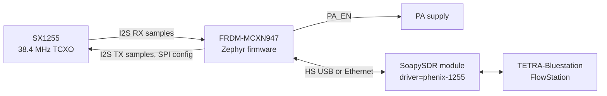

<p align="center">
  <picture>
    <source media="(prefers-color-scheme: dark)" srcset="_doc/images/phenix-1255_logo_white.png">
    
  </picture>
</p>

<p align="center">
  <b>SX1255 SDR transceiver for TETRA base stations</b><br>
  Zephyr firmware on the NXP FRDM-MCXN947 · timestamped I/Q over HS USB or Ethernet · SoapySDR driver
</p>

<p align="center">
  <a href="https://github.com/w4tchd0g/phenix-1255-sw/actions/workflows/build.yml"></a>
  
  
  
  
</p>

<p align="center">
  <a href="#getting-started">Getting started</a> ·
  <a href="#5-run-a-tetra-base-station">Run a base station</a> ·
  <a href="#serial-console">Serial console</a> ·
  <a href="#troubleshooting">Troubleshooting</a> ·
  <a href="#documentation">Documentation</a>
</p>

## About

Phenix-1255 streams timestamped I/Q samples from a Semtech SX1255
transceiver to a host and back. The project consists of a Zephyr firmware
for the NXP FRDM-MCXN947 and a SoapySDR module (`driver=phenix-1255`) for
TETRA base station software such as
[TETRA-Bluestation](https://github.com/MidnightBlueLabs/tetra-bluestation)
and [FlowStation](https://github.com/razvanzeces/flowstation).

Phenix-1255 is a joint project: the [phenix-1255-hw](https://github.com/labdvm/Phenix-1255-HW) board was
developed by **Z32IT**, the firmware and host software are in this
repository.

### Difference to a Raspberry Pi HAT

SX1255 boards are often built as a HAT for a Raspberry Pi, where Linux on the
Pi receives the I2S samples and runs the base station at the same time.
Phenix-1255 moves the sample path onto a dedicated microcontroller instead:

| | SX1255 HAT on a Raspberry Pi | Phenix-1255 |
|---|---|---|
| Sample timing | I2S stream handled by a general-purpose OS; timestamps depend on driver buffering and scheduling | Every sample counted in hardware (DMA position), timestamp exact to the sample, TX placed on an exact sample |
| Host | Fixed to the Pi the HAT sits on | Any Linux or macOS computer, e.g. a laptop, a PC or an existing server |
| Placement | Radio and computer in one place | Over Ethernet the radio can sit near the antenna, the computer elsewhere |
| PA safety | Depends on the host software and OS behaving correctly | Firmware switches the PA off on link loss, errors or a hang (watchdog), independent of the host |
| Start-up and maintenance | Pi OS on an SD card, updates and drivers on the Pi | Firmware starts in seconds, nothing to maintain on the radio side |
| Standalone status | Needs a login on the Pi | Front panel display, status LEDs, web interface and serial console |

The host still runs the TETRA stack; Phenix-1255 replaces the HAT and its
timing-critical driver, not the base station software.

> [!NOTE]
> **Status:** firmware 0.1.0-dev. The target hardware is the
> [phenix-1255-hw](https://github.com/labdvm/Phenix-1255-HW) board on the FRDM-MCXN947 (SX1255, status LEDs, PA
> enable MOSFET, OLED display and rotary encoder). The first tests were made with a µCell board
> wired to the FRDM-MCXN947: streaming over HS USB and Ethernet, the front
> panel display and over-the-air operation with FlowStation work. A µCell
> board or another SX1255 board built the same way is therefore usable as
> well, with a reduced feature set (see
> [hardware.md](_doc/hardware.md#µcell-and-compatible-boards)). The Zephyr revision is pinned
> to v4.5.0-rc3 until v4.5.0 is released. Open points:
> [roadmap.md](_doc/roadmap.md).

### At a glance

| | |
|---|---|
| Transceiver | Semtech SX1255, 400 to 510 MHz, 38.4 MHz TCXO, full duplex |
| Sample rates | 600 (default), 300, 150, 75, 50, 25 kHz |
| Timing | Shared 64-bit RX/TX sample counter, exact timed TX, constant TX-to-RX loop delay |
| Host link | HS USB (vendor class, bulk) or Ethernet (TCP control, UDP samples), selected by the `COMM_SEL` switch |
| Host software | SoapySDR module for Linux and macOS, patches for TETRA-Bluestation and FlowStation |
| Safety | PA enable only while TX streams, immediate shutdown on link loss or errors, hardware watchdog |

### How it works



The SX1255 is the I2S clock source. The firmware counts every I2S frame and
stamps each sample with a 64-bit counter shared by RX and TX, so the host
knows the exact sample time of every RX packet and can place TX packets on
an exact sample. Details: [architecture.md](_doc/architecture.md).

## Features

**Radio and timing**
- SX1255 with 38.4 MHz reference, independent RX and TX synthesizers.
- Sample counter derived from the SAI DMA position; every RX packet carries
  its counter value, timed TX packets are emitted exactly at their sample.
- Constant TX-to-RX loop delay per rate (see
  [stream.md](firmware/src/stream/_doc/stream.md#tx-to-rx-loop-delay)).

**Host link**
- HS USB or Ethernet, selected at boot by the `COMM_SEL` switch.
- Ethernet: DHCP with fallback to `192.168.2.10/24`, static configuration,
  mDNS name `phenix-1255.local`, web interface for the network settings
  (active in both modes).

**Safety**
- PA enable output switched only on TX stream start/stop, with immediate
  shutdown on link loss or errors; hardware watchdog.
- Factory reset by holding SW2 during boot.
- Hardware variant detection (HW_ID solder jumpers); the firmware does not
  start on unsupported hardware.

**Front panel**
- 0.96" SSD1306 OLED with status pages (frequencies, link, network, gains,
  counters) and a menu operated with a rotary encoder for display, network,
  reboot and factory reset settings.

**Host software**
- SoapySDR module for Linux and macOS: timestamps on every read, exact timed
  writes, `getHardwareTime()`.
- Patches for TETRA-Bluestation and FlowStation.

## Getting started

These steps lead from a fresh clone to a running TETRA base station on a
Linux or macOS host. The linked documents contain the details.

> [!WARNING]
> **Transmitting:** connect the TX output only to an attenuator or dummy
> load, or to a PA and antenna on a frequency you are allowed to transmit on
> (e.g. as a licensed radio amateur in the 70 cm band).

### 1. Hardware

- NXP FRDM-MCXN947 with the [phenix-1255-hw](https://github.com/labdvm/Phenix-1255-HW) board (schematic, Gerber
  files and BOM in its repository), or a µCell or compatible
  SX1255 board wired as listed in
  [hardware.md](_doc/hardware.md#pin-assignment) (reduced feature set, see
  [hardware.md](_doc/hardware.md#µcell-and-compatible-boards)).
- USB cable to J17 (MCU-Link) for flashing and the console.
- Host link, selected by the `COMM_SEL` switch when the board boots:

  | `COMM_SEL` (P2_7) | Host link | Connection |
  |---|---|---|
  | Open (high) | HS USB | HS USB port of the FRDM-MCXN947 |
  | Closed to GND (low) | Ethernet | Ethernet port, network with DHCP or 192.168.2.0/24 |

  Ethernet and the web interface are active in both modes.

### 2. Build and flash the firmware

Install the host packages, the
[Zephyr SDK](https://docs.zephyrproject.org/latest/develop/getting_started/index.html)
and NXP LinkServer (must be in `PATH`) once:

```sh
# Debian/Ubuntu
sudo apt install --no-install-recommends git cmake ninja-build gperf ccache \
    dfu-util device-tree-compiler wget python3-dev python3-venv python3-tk \
    xz-utils file make gcc libsdl2-dev libmagic1
# macOS (Homebrew)
brew install cmake ninja gperf python3 ccache dtc wget libmagic
```

Create a west workspace around the repository, build and flash:

```sh
mkdir phenix-1255-ws && cd phenix-1255-ws
git clone <repository-url> phenix-1255-sw
python3 -m venv .venv && source .venv/bin/activate
pip install west
west init -l phenix-1255-sw && west update
west zephyr-export && west packages pip --install

cd phenix-1255-sw
west build -b frdm_mcxn947/mcxn947/cpu0 -d build/firmware firmware
west flash -d build/firmware
```

On phenix-1255-hw the green LED blinks slowly when the device is ready.
Existing Zephyr workspaces and J-Link are covered in
[building.md](_doc/building.md).

### 3. Build the SoapySDR module

<details open>
<summary><b>Linux</b></summary>

```sh
sudo apt install --no-install-recommends libsoapysdr-dev soapysdr-tools cmake g++ \
    pkg-config libusb-1.0-0-dev
cmake -S soapy -B build/soapy
cmake --build build/soapy -j
# USB access for normal users
sudo cp soapy/udev/99-phenix-1255.rules /etc/udev/rules.d/
sudo udevadm control --reload-rules && sudo udevadm trigger
```

</details>

<details open>
<summary><b>macOS</b></summary>

```sh
brew install soapysdr cmake pkg-config libusb
cmake -S soapy -B build/soapy -DCMAKE_PREFIX_PATH="$(brew --prefix)"
cmake --build build/soapy -j
```

</details>

The module can be used straight from the build directory: SoapySDR also
searches the directories in `SOAPY_SDR_PLUGIN_PATH`. Alternatively install
it with `sudo cmake --install build/soapy` (Linux) or
`cmake --install build/soapy` (macOS).

### 4. Check the device

```sh
export SOAPY_SDR_PLUGIN_PATH="$PWD/build/soapy"     # not needed after installing
SoapySDRUtil --probe="driver=phenix-1255"                          # HS USB
SoapySDRUtil --probe="driver=phenix-1255,addr=phenix-1255.local"   # Ethernet
build/soapy/phx_soapy_test rx "driver=phenix-1255" 10              # 10 s RX check
```

On Ethernet the device uses DHCP. Without a lease after 30 s it adds the
fallback address **192.168.2.10/24** (yellow LED on). The web interface at
`http://phenix-1255.local/` (or the device IP address) shows the status and
changes the network settings; it has no authentication, so use the device on
a trusted network only. Holding SW2 during boot restores the factory
defaults.

| Device argument | Default | Description |
|---|---|---|
| `transport` | USB if attached and no `addr`, else Ethernet | `usb` or `eth` |
| `addr` | `phenix-1255.local` | Host name or IPv4 address (Ethernet) |
| `serial` | | Select one of several USB devices |

All arguments are listed in [soapy.md](soapy/_doc/soapy.md#device-arguments).

### 5. Run a TETRA base station

Both stations open SoapySDR devices and detect the Phenix-1255 by its driver
key once the patch from [`patches/`](patches/_doc/patches.md) is applied. The
patch sets the sample rate (600 kHz), antennas and gains.

<details open>
<summary><b>FlowStation</b></summary>

```sh
git clone https://github.com/razvanzeces/flowstation && cd flowstation
git checkout 0f4faa9
git apply /path/to/phenix-1255-sw/patches/flowstation/0001-add-phenix-1255.patch
cargo build --release
cp example_config/config.toml config.toml    # set tx_freq, rx_freq, mcc, mnc
```

</details>

<details open>
<summary><b>TETRA-Bluestation</b></summary>

```sh
git clone https://github.com/MidnightBlueLabs/tetra-bluestation && cd tetra-bluestation
git checkout 09d4e0d
git apply /path/to/phenix-1255-sw/patches/tetra-bluestation/0001-add-phenix-1255.patch
cargo build --release
cp example_config/config.toml config.toml    # set tx_freq, rx_freq, mcc, mnc
```

</details>

Over **HS USB** no `device` entry is needed: the station opens the first
supported device. Over **Ethernet** the device must be given in
`[phy_io.soapysdr]` of `config.toml`:

```toml
device = "driver=phenix-1255,addr=phenix-1255.local"   # or addr=192.168.2.10
```

Start the station. If the module is not installed, pass its build directory
on the same command line, so nothing else in the shell changes:

```sh
SOAPY_SDR_PLUGIN_PATH=/path/to/phenix-1255-sw/build/soapy ./target/release/bluestation-bs config.toml
```

The command is the same for both stations. On the console, `stream status`
should show 0 dropped RX samples and no FIFO or frame sync errors after a
run (see [Serial console](#serial-console)). Both stations log
`Lost -1200 samples` and `Too late to produce TX block 0` once at start; this
comes from their start-up sequence and is followed by normal operation.

## Serial console

The firmware shell runs on the MCU-Link virtual COM port (J17, 115200 baud,
8N1). `Tab` completes commands, `help` lists them.

```sh
# Linux
python3 -m serial.tools.miniterm /dev/ttyACM0 115200
# macOS (ls /dev/cu.usbmodem* shows the device name)
python3 -m serial.tools.miniterm /dev/cu.usbmodemXXXX 115200
```

`pyserial` is part of the Zephyr Python environment; `screen` or `tio` work
as well.

**Useful commands**

| Command | Shows or does |
|---|---|
| `phenix status` | Host link selected by `COMM_SEL`, PA state |
| `sx1255 info` | Frequencies, sample rate, gains, PLL lock, RX input |
| `stream status` | Sample counter, dropped RX samples, late/early TX packets, FIFO and frame sync errors |
| `stream rxstats` | RX level, DC offset and dominant tone of the received signal (while a stream runs) |
| `phenix config show` | Stored network configuration |
| `net iface` | Current IP address, link state and MAC address |
| `net ping 192.168.2.1` | Reachability of a host from the device |
| `phenix display dump` | Front panel content as text |
| `kernel uptime` | Time since boot |
| `kernel thread stacks` | Stack usage of all threads |
| `kernel reboot cold` | Reboot |

**Set a static address** (takes effect after the reboot):

```
phenix config set dhcp off
phenix config set ip 192.168.2.10
phenix config set netmask 255.255.255.0
phenix config set gateway 192.168.2.1
kernel reboot cold
```

`phenix config set dhcp on` returns to DHCP. Commands that emit RF, such as
`sx1255 txdrv on` and `stream tone`, need the same RF setup as the
transmitting tests. All commands: [shell.md](firmware/src/shell/_doc/shell.md).

## Troubleshooting

| Symptom | Cause and solution |
|---|---|
| Linux: device listed with "no access" | udev rule not installed, see [step 3](#3-build-the-soapysdr-module) |
| Station or `SoapySDRUtil` does not find `phenix-1255` | Module not installed and `SOAPY_SDR_PLUGIN_PATH` not set; `SoapySDRUtil --info` lists the search paths and loaded modules |
| `SoapySDRUtil --find` does not list the Ethernet device | A generic enumeration does not search the network; pass `driver=phenix-1255` or `addr=...` |
| Ethernet: web interface works, but SoapySDR cannot connect | `COMM_SEL` is open (HS USB), the control and sample channels run over USB only; set the switch to GND (Ethernet) and reset the board |
| Second application is rejected | Only one host session at a time is supported |
| `phenix-1255.local` resolves slowly on macOS | macOS also asks for an IPv6 address; use the IP address |
| Device unreachable after changing the network settings | Hold SW2 during boot (factory reset) or use `phenix config` on the console, see [ethernet.md](firmware/src/ethernet/_doc/ethernet.md) |

## Repository layout

| Path | Content |
|---|---|
| `firmware/` | Zephyr application for the FRDM-MCXN947, one folder per module in `firmware/src/` |
| `common/` | Wire protocol definitions shared by firmware and host |
| `soapy/` | SoapySDR module, test programs in `soapy/tests/`, udev rule in `soapy/udev/` |
| `tools/` | Protocol test client, logo converter for the front panel start screen |
| `patches/` | Patches for TETRA-Bluestation and FlowStation |
| `_doc/`, `*/_doc/` | Documentation, next to the code it describes |
| `west.yml` | West manifest pinning the Zephyr revision |

## Documentation

Every software module documents itself in a `_doc/` folder next to its
code.

| Area | Documents |
|---|---|
| System | [Architecture](_doc/architecture.md) · [Hardware](_doc/hardware.md) · [Building](_doc/building.md) · [Testing](_doc/testing.md) · [Roadmap](_doc/roadmap.md) |
| Firmware | [Structure, threads, memory, PA safety](firmware/_doc/firmware.md) |
| Firmware modules | [Board I/O](firmware/src/board/_doc/board.md) · [Configuration](firmware/src/config/_doc/config.md) · [SX1255](firmware/src/radio/_doc/radio.md) · [Sample stream and timing](firmware/src/stream/_doc/stream.md) · [Control](firmware/src/control/_doc/control.md) · [Ethernet](firmware/src/ethernet/_doc/ethernet.md) · [HS USB and test PID](firmware/src/usb/_doc/usb.md) · [Front panel](firmware/src/display/_doc/display.md) · [Console commands](firmware/src/shell/_doc/shell.md) |
| Protocol | [Wire protocol](common/_doc/protocol.md) |
| Host | [SoapySDR module](soapy/_doc/soapy.md) · [Test programs](soapy/tests/_doc/tests.md) · [Protocol test client](tools/_doc/phx_client.md) · [Logo converter](tools/_doc/logo_to_c.md) |
| Stations | [Patches for TETRA-Bluestation and FlowStation](patches/_doc/patches.md) |

## Acknowledgements

The phenix-1255-hw board was developed by Z32IT
([Phenix-1255-HW](https://github.com/labdvm/Phenix-1255-HW)).

The SX1255 register configuration follows
[SoapySX](https://github.com/tejeez/sxxcvr) (SXceiver) and
[SoapyMuCell](https://github.com/Jankyneering/mu-cell-bb-drivers) (µCell).

## License

MIT, see [LICENSE](LICENSE).
